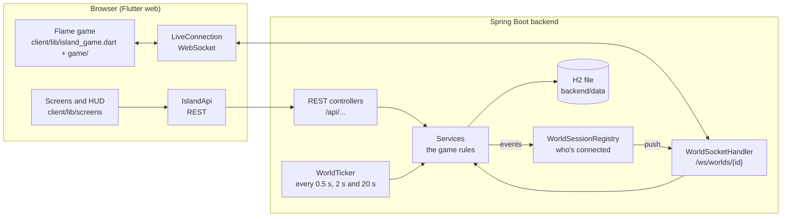

# Architecture

## Overview

The **backend** holds every rule and all data. The **client** draws the
world, sends what the player wants to do, and simulates movement (the
server tells it which paths to follow). See D1, D3 and D4 in
[decisions.md](decisions.md).

## How a session flows

1. **Welcome screen:** REST `GET /api/users` and `GET /api/worlds`. The user
   list refreshes every few seconds to show who's playing.
2. **Entering a world:** REST `GET /api/worlds/{id}/islands` (the layout,
   which never changes), then the WebSocket connects.
3. **Snapshot:** the server sends everything needed to draw the world:
   buildings, boats, players, resource spots, your inventory and hunger,
   recipes, and where you left off.
4. **Join:** the client sends `join`, and from then on others can see you.
5. **Playing:**
   - *Actions* go over the socket: move, board, sail, land, gather, eat,
     inventory changes, crafting, collecting.
   - *Commands with a yes/no answer* go over REST: build, destroy, build a
     boat. Their results are also pushed to everyone over the socket.
   - The server broadcasts shared changes to everyone in the world, and
     sends private ones (inventory, hunger) only to that player.
6. **Reconnecting:** `LiveConnection` retries with growing pauses. The server
   sends a fresh snapshot, and the client catches up, then re-sends `join`,
   what it's holding, and any movement in progress.

The full message list is in [protocol.md](protocol.md).

## Backend

`backend/src/main/java/com/example/testproject/`

| Package | What's in it |
|---|---|
| `controller` | REST endpoints and the JSON error format (`ApiExceptionHandler`) |
| `live` | The WebSocket: `WorldSocketHandler` (reads messages), `LiveWorldService` (joining, moving, boarding, gathering and similar actions), `WorldSessionRegistry` (connections, broadcasting, the one-tab-per-user claim), `LiveEvents` (the messages the server sends), `WorldTicker` (the background tick) |
| `service` | The rules: `WorldService` (worlds, islands, buildings, boats, lumberjacks), `ResourceNodeService` (spots, gathering, drops and catch-up, item piles), `AnimalService` (animals and how they behave), `InventoryService`, `CraftingService`, `PlayerVitalsService` (hunger and health), `UserService` |
| `model` | JPA entities, plus `dto` (what's sent) and `req` (what's received) |
| `repository` | Spring Data repositories |
| `config` | CORS and WebSocket setup, scheduling, and `LegacySchemaCleanup` (see D13) |

Things worth knowing:
- **Nothing ticks per player.** Hunger, health, lumberjack storage and
  regrowth are calculated from timestamps when read (D12). Only
  `WorldTicker` runs on a schedule, for worlds someone is playing in:
  every 0.5 s the animals decide what to do, every 2 s players' vitals are
  brought up to date (and deaths noticed), and every 20 s loose items and
  animals appear and expired item piles are removed. Tests switch it off
  (`game.ticks.enabled: false`) and call the ticks directly.
- **Animals** live in memory only (`AnimalService`), not in the database
  (D24).
- **Errors** are thrown as `ResponseStatusException` with a readable
  reason. REST returns it as `{"message": ...}`, and the socket sends it as
  an `error` event to that player only.
- **Order of sends:** each world has a lock that every broadcast goes
  through. A new connection is registered and sent its snapshot while
  holding that lock, so it can't miss or double up on an event.

## Client

`client/lib/`

| File or folder | What's in it |
|---|---|
| `main.dart` | App entry point |
| `screens/welcome_screen.dart` | Picking a user and a world |
| `screens/island_screen.dart` | The game screen: connection, applying server events in order, menus, keyboard |
| `screens/hud.dart` | Small on-screen panels (hunger, coordinates, zoom, reconnecting) |
| `api.dart` | REST calls and their data types |
| `protocol.dart` | Turning server JSON into game types, and back |
| `live_connection.dart` | The WebSocket with automatic reconnect |
| `island_game.dart` | The Flame game: camera, input, and applying world changes |
| `game/` | Everything drawn in the world (islands, player, boats, buildings, resource spots) and `records.dart` (plain data from the server) |
| `inventory.dart` | Items, the quick-access bar, bag, craft sheet and item icons |
| `minimap.dart` | The minimap |

Things worth knowing:
- **Server events are applied one at a time** in the order they arrive
  (`_eventQueue` in `island_screen.dart`), because some take a moment
  (spawning things).
- **Optimistic building:** a building you place appears right away without
  an id. When the server confirms it, by REST reply or push, whichever
  comes first, it's matched up (`addBuilding`).
- **Movement** uses `PathFollower` (`game/player.dart`), so given the same
  path, every client puts a player or boat in the same place at the same
  time.
